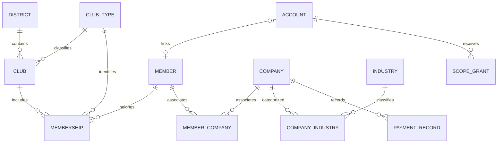

# 共通資料模型與 API 規則（提案）

> 現行狀態（2026-10-15）：剩餘規格已依使用者授權補齊，請先讀[需求基準 v1.0](13-requirements-baseline.md)、[權限矩陣](14-role-matrix.md)及[現行階段清單](11-development-phases.md)。下方保留來源分析與歷次討論；其中「待確認／提案」及舊狀態僅供追溯，已由現行基準處理。程式與驗收尚未完成。

## 來源與歷次討論（非現行待辦）

狀態：討論稿；尚未選定框架、資料庫、登入方式與 API 版本策略。

## 關聯與責任

社籍子表與類型擴充方向已確認；此圖其他部分為候選概念模型。ACCOUNT／MEMBER 的一對一及可空性、PAYMENT_RECORD 是否應改為 APPLICATION_RECORD 均待確認。Event 以主辦類型與 ID 指向地區或社團，必須驗證目標存在及授權；正式模型可改用單一 Organization 外鍵，需決策後才定稿。

| 資料 | 主責模組 | 設計約束 |
| --- | --- | --- |
| 帳號、角色、授權 | AUTH | 密碼與復原憑證不外洩；授權範圍由伺服器推導 |
| 地區、社團 | ORG | ID 與舊 UPMS/CMS 對應分開保存 |
| 會員與會籍 | MEM | 社籍子表關聯社團與類型；有效扶青社及扶輪社籍各至多一筆，歷史保留且不自動授權 |
| 活動 | EVT | 明確主辦、可見性、時區、發布狀態 |
| 公司、產業、會員公司關係 | BIZ | 分類與關聯結構化；座標可空 |
| 企業申請／繳費紀錄 | PAY | 業務語意未決；不可直接推論金流或有效期 |
| 檔案、稽核 | 共通 | 不儲存於公開可任意寫入路徑；敏感內容不進日誌 |

## API 共通契約

- ID 對外以不具業務語意的字串表示；內部型別於選型決定。跨模組不可混用不同 ID 命名空間。
- 欄位白名單輸入、輸出；不直接序列化資料庫 Entity。PATCH 的未提供表示不修改，明確 null 僅允許在可清除欄位；空字串依欄位規則驗證。
- 列表草案使用 `page`（從 1 起）、`pageSize`（預設 20、上限 100）、明確允許的排序；回傳 `items`、`page`、`pageSize`、`total`。數值為待確認預設。
- 錯誤回應包含穩定 `code`、可理解 `message`、`fieldErrors`、`requestId`，不包含堆疊、SQL、秘密、密碼或其他會員資料。
- 400：格式／欄位無效；401：未登入；403：無權限；404：不存在或統一防枚舉政策；409：版本／狀態衝突；429：過量請求；5xx：非預期服務失敗。防枚舉政策需一致，不以端點差異洩漏私有資料。
- 變更操作不得用 GET。資料更新使用 `version` 或等價條件更新，拒絕覆蓋他人已修改版本。
- 建立或登錄重送應有冪等策略；有金額／申請紀錄的操作須定義冪等鍵與保存期間，正式值待討論。
- 公開 API 和管理 API 使用不同資料投影；公開快取只含白名單欄位，撤回公開後需定義失效時間。
- 日期時間：具體時間傳遞 RFC 3339；全天日期用 YYYY-MM-DD，結束日不包含；時間顯示預設 Asia/Taipei 待確認。

## 待定稿清單

技術選型後、開發前補齊逐端點 schema：必填、長度、枚舉、精度、空值、錯誤碼、授權與範例。上述契約為初稿，不表示正式 OpenAPI 已完成。刪除、封存、稽核與跨模組交易應先確定業務規則再寫入詳細契約。

## 已確認的社籍關聯

Member → Membership → Club／ClubType。社籍上限依會員與類型分別驗證；歷史社籍保留，不能只以目前 clubId 取代所有經歷。類型一致性、期間、併發限制與資料字典詳見 [社籍與歷史規格](12-membership-and-history.md)。儲存層約束依技術選型落實，此次不建立資料表或程式。

## 歷史公開與同意資料

歷史 visibility 與社籍 status 分開；同意請求綁定 memberId、membershipId、內容版本與公開設定版本。pending 不代表 public。除本人或特定 admin 例外外，任何公開變更都須有對應本人同意紀錄，不能以通用 PATCH 繞過。欄位候選、原子操作與版本失效規則見 [社籍與歷史規格](12-membership-and-history.md)。

## 帳號識別與入社申請補充（2026-10-15）

帳號代號首次亂數產生，僅可修改一次；電話與 Email 均可變更且可登入。已確認以不可變 accountId 關聯會員、社籍與歷史，accountCode 作為獨立可修改一次的唯一代號，不以電話、Email 或姓名作永久關聯鍵；帳號代號亦可用於登入。入社申請與有效社籍分開，只有該社團管理者核准後才在對應頁面顯示；審核狀態、欄位及核准後生效日期待定。

通用會員查詢須同時符合入社核准門檻與本人欄位隱私設定；會員公司在通用地圖亦須符合所屬會員的社團資格，無所屬社團時不顯示。各入口與 API 均執行相同資格及欄位投影檢查，不以畫面隱藏取代。資格失效時機、隱私欄位及多會員共用公司規則待確認。

## 通用與登入入口區分（2026-10-15 已確認）

未登入訪客可瀏覽商家地圖、社團行事曆；會員資料查詢與商家優惠兌換須登入後才可使用。優惠兌換的功能範圍、階段及流程另議，不因入口規則而列為第一階段交付。

會員電話預設隱藏、會員 Email 預設開啟，兩者皆可由本人以 checkbox 調整。會員資料查詢仍須登入，預設開啟不代表匿名 API 可取得會員私人欄位；授權管理者備查範圍另定。

沒有任何有效社籍時，預設會員查詢排除該會員，但登入使用者可勾選特殊選項查詢已退出、OB 等非正常社籍會員，仍套用欄位隱私；商家地圖以當年度社籍為免費資格，非當年度社友可付費以廣告形式曝光，不設年資門檻；付費曝光自平台管理者設定起始日起一年，到期未續費則下架地圖並保留資料；保留本人資料與歷史，多會員共用公司規則另議。顯示資格與隱私檢查須涵蓋搜尋、詳情、API 與本系統快取；撤回機制實作後驗收。

## 識別欄位唯一性（2026-10-15 已確認）

call name 可重複，以社團輔助辨識；Email 作為登入識別須全平台唯一，註冊與變更均須檢查。永久關聯仍使用不可變 accountId，不以 call name、Email 或電話取代。Email 正規化規則待定，儲存層須防止併發寫入重複值。

## 電話、帳號代號與密碼復原（2026-10-15 已確認）

- 電話可用於登入，同一電話只能綁定一個帳號；以含國碼的格式儲存，支援國際使用。電話仍為選填，未填不占唯一值；具體國碼正規化與格式驗證待定稿。
- 帳號代號允許英文字母、數字與底線，長度 6～20 字元，不分大小寫且全平台唯一；首次由系統亂數產生，僅可修改一次。
- 修改成功後，舊帳號代號不再可登入，且永久保留、不重新分配；代號修改不改變內部 accountId 或既有資料關聯。註冊產生與修改均須排除現用及保留代號。
- 忘記密碼採寄送一次性、限時有效的重設連結到已登錄 Email；成功後撤銷該復原憑證與既有登入狀態。具體有效期限、重送與頻率限制另定。
- 電話簡訊復原留待後續；Email 無法收信時的例外復原流程另議。
- Email 復原與變更電話／Email 的本人密碼驗證為不同流程；前者須串接寄信服務，不代表本階段新增電話／Email 變更驗證碼。

## 本人資料與社籍異動紀錄（2026-10-15 已確認）

- 姓名、電話、Email、帳號代號及社籍異動均記錄操作者、時間與變更內容。
- 僅本人及具明確權限的管理者可查；管理者需遵守所屬社團／地區與欄位範圍，不得因可看異動紀錄而讀到其他社籍或未授權個資。
- 不記錄密碼內容，亦不記錄復原憑證或驗證碼；敏感異動紀錄與一般系統日誌分開處理。
- 舊新值遮罩、保留期限、本人可查欄位、匯出及歷史管理者查閱範圍仍待定稿。
