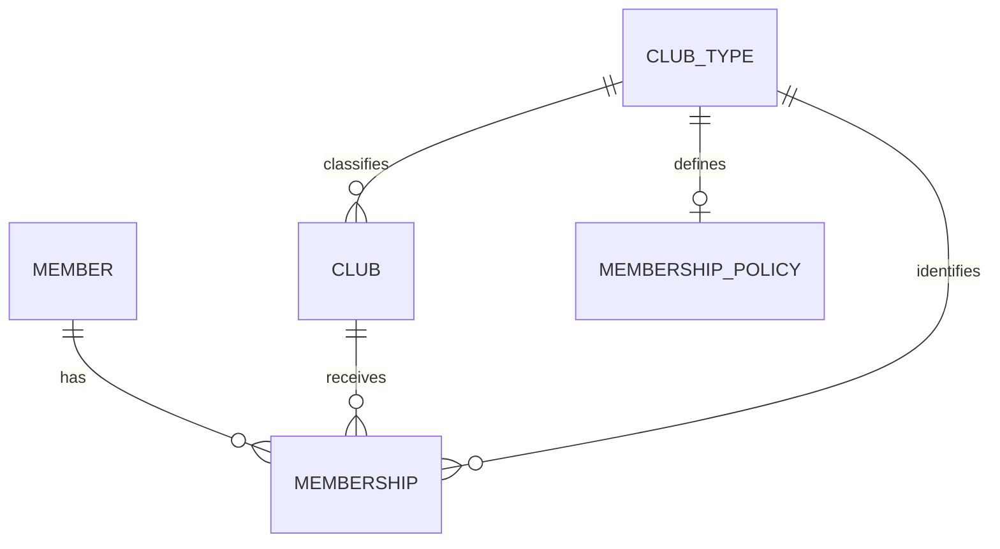
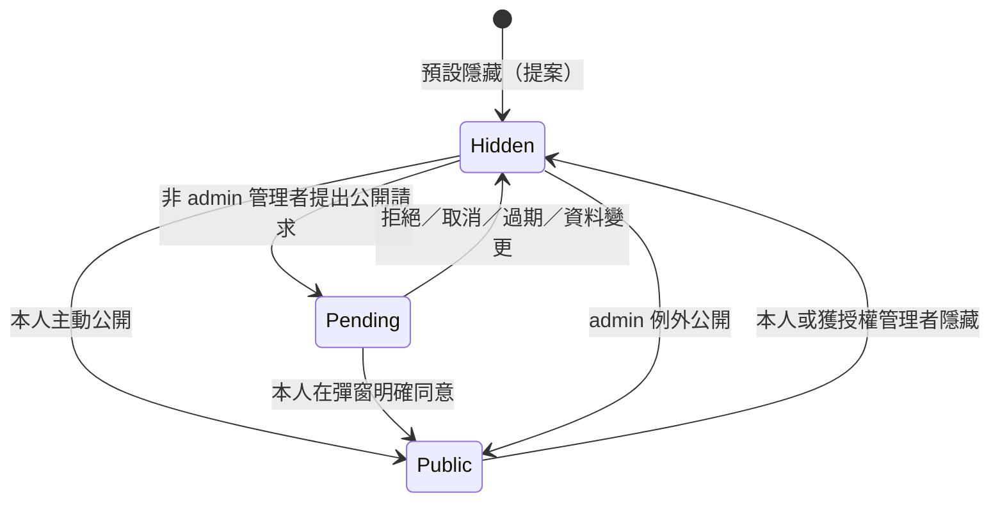

# 社籍子表、社團類型與歷史經歷

> 現行狀態（2026-10-15）：剩餘規格已依使用者授權補齊，請先讀[需求基準 v1.0](13-requirements-baseline.md)、[權限矩陣](14-role-matrix.md)及[現行階段清單](11-development-phases.md)。下方保留來源分析與歷次討論；其中「待確認／提案」及舊狀態僅供追溯，已由現行基準處理。程式與驗收尚未完成。

## 來源與歷次討論（非現行待辦）

狀態：社籍上限、子表關聯、類型擴充、歷史保留及公開決定權已確認；欄位與操作細節為設計提案。日期：2026-10-14。[規格索引](README.md)

## 已確認需求

- 每位會員同一時間最多一個扶青社籍。
- 預留扶輪社整合：同一位會員可同時有一個扶輪社籍與一個扶青社籍。
- 社籍以會員子表關聯社團，標示所屬社團類型；未來可擴充青商會與 BNI。
- 保留歷史社籍，用於經歷顯示或備查；轉社不能覆寫掉先前社籍。
- 每筆歷史經歷是否公開由會員本人決定。較高權限管理者可協助隱藏，但重新公開須經會員本人在彈窗明確同意，不可代為同意；admin 可例外直接公開。

扶輪社、青商會、BNI 的正式功能上線順序尚未確認。青商會與 BNI 的同時社籍數量及有效資格規則另行設定，不套用未經確認的規則。

## 概念關聯

會員主表保存個人資料，不直接放單一 clubId 或固定的 rotaryClubId／rotaractClubId 欄位。每段社籍為一筆 Membership；未來增加類型不需新增會員主表欄位。

## 資料字典草案

| 資料 | 欄位候選 | 用途與限制 |
| --- | --- | --- |
| ClubType 社團類型 | id、code、name、enabled | 受控類型；代碼候選 ROTARACT、ROTARY、JCI、BNI，代碼正式值待定 |
| Club 社團 | id、clubTypeId、districtId、name、status | 社團明確屬於一種類型；不同體系的地區階層對應另行定義 |
| Member 會員主表 | id、accountId、個人基本資料 | 同一人跨類型使用同一會員身分；不可為新增扶輪社籍另建重複會員 |
| Membership 社籍子表 | id、memberId、clubId、clubTypeId、status、startsOn、endsOn、endReason、version | 一筆表示一段社籍；clubTypeId 必須與關聯 Club 的類型一致，不接受任意標籤 |
| Membership 歷史描述 | clubNameAtStart、typeNameAtStart、districtAtStart | 候選歷史快照，避免改名或移區使舊經歷失真；實際快照欄位待定 |
| Membership 移轉資訊 | sourceSystem、sourceRecordId、datePrecision、verificationStatus | 候選欄位；記錄舊資料來源、未知日期與待核實狀態，不猜造日期 |
| MembershipPolicy 類型規則 | clubTypeId、maxActiveMemberships | 扶青社、扶輪社各為 1；未核定規則的未來類型不得直接啟用社籍寫入 |
| 歷史公開設定 | membershipId、visibility（hidden/public）、visibilityVersion、publishedContentVersion、audienceVersion、publicationBasis、changedBy、changedAt | 每筆歷史社籍獨立設定，與社籍有效／結束狀態分開；新建／移轉預設隱藏為提案 |
| 公開同意請求 | id、membershipId、subjectMemberId、requestedBy、contentVersion、visibilityVersion、status、requestedAt、expiresAt、decidedAt | 綁定本人與指定歷史資料版本；狀態與期限方案見下文，未同意不公開 |
| 社籍異動稽核 | membershipId、action、actorId、recordedAt、reason | 記錄建立、結束、轉社及更正；異動稽核與公開經歷分開 |

Club 是社團類型的權威來源；Membership 保留類型欄位以便限制、查詢與歷史識別。兩者一致性由關聯約束或等價機制保證；具體資料庫方式待選型。已有社籍引用的社團不能直接改成另一類型，應以明確資料更正／重建流程處理並保留歷史。

## 社籍有效性與上限

- **MEMSHIP-01（已確認）**：目前有效扶青社籍數量 ≤ 1，有效扶輪社籍數量 ≤ 1；兩種類型分別計算，不把會員全體有效社籍限制成只能一筆。
- **MEMSHIP-02（提案）**：狀態使用 active（有效）、ended（已結束）、void（誤建後作廢）。作廢不等於曾經入社，不列為經歷，但保留備查。未來生效、停籍、榮譽社籍是否需要另議。
- **MEMSHIP-03（提案）**：已知期間使用 startsOn 含起日、endsOn 不含迄日；無結束日代表尚未結束。有效社籍須同時符合狀態與期間，不以缺少 endsOn 單獨判定。跨期顯示與同日轉社的文字說明需保持一致。
- **MEMSHIP-04（提案）**：同類型社籍的已知期間不得重疊；結束歷史不占目前有效名額。不完整或缺少日期的舊歷史標示待核實，不偽裝為精確期間。active 來源資料即使缺少起日仍需遵守每類型一筆上限。
- **MEMSHIP-05（提案）**：併發加入、重送或轉社必須在儲存層保證上限；不能只靠畫面或寫入前查詢。資料庫選定後再決定唯一條件與交易鎖定方式。
- **MEMSHIP-06（擴充方向已確認；啟用條件為提案）**：不同類型共存不代表任何類型可以無限制多社；新類型先核定規則，再啟用。

## 加入、轉社、結束與歷史

同類型轉社採「結束原社籍 + 新增目標社籍」，在一次受控操作中完成，保留原社團、期間與異動紀錄；任一步驟失敗整體回復，不能讓會員同時有兩個有效扶青社籍或意外失去原社籍。轉社由本人提出，經原社團與目標社團管理者雙方核准後，再由本人最終確認執行才生效；不自動賦予單一社團管理者操作其他社團的權限。

不同類型新增社籍只新增對應子表資料，不結束既有另一類型社籍。例如新增扶輪社籍時，原扶青社籍保持有效。

退社及扶青社畢業（OB）的辦理角色已確認，詳見下方流程；OB 的資料狀態與權益仍待確認，已結束社籍仍保留。歷史更正須保留原值、理由與操作者；重新加入同一社團應新增另一段經歷，不重啟或覆寫上一段已結束記錄。

## 經歷顯示與查閱邊界

- 經歷欄位候選：社團類型、社團名稱、起迄期間與目前／已結束狀態。未知日期顯示「日期待核實」或已知精度。
- **已確認**：會員本人自行選擇每筆歷史經歷公開或隱藏；較高權限管理者可協助隱藏，非 admin 管理者公開前須取得會員本人同意。公開欄位白名單、備查閱覽範圍與管理角色對應仍待定稿。
- 社團管理者只能管理自己社團的社籍；地區管理者僅限轄內社團。管理某一筆社籍不代表能查看或修改該會員其他類型、其他社團的全部資料。
- 歷史社籍不自動授予現行會員或管理權限，也不讓原社團管理者取得會員轉社後的新資料。原社團歷史紀錄備查的權限、期間與允許欄位需另定。
- 經歷展示不帶出內部備註、私人聯絡資訊、作廢原因、原始移轉資料或稽核細節。
- 青商會與 BNI 不直接套用扶輪地區管理範圍；各類型組織階層與管理授權先設計再啟用。

## 歷史資料公開與同意機制

### 已確認的操作權限

| 操作者 | 隱藏該筆歷史經歷 | 將隱藏經歷公開 |
| --- | --- | --- |
| 會員本人 | 可自行隱藏 | 可自行選擇公開 |
| 較高權限管理者（非 admin） | 可在其授權範圍內協助隱藏 | 只能提出請求；會員本人在彈窗明確同意後才公開 |
| admin | 可隱藏 | 例外可直接公開，無須會員同意 |
| 其他使用者 | 不可 | 不可 |

「較高權限管理者」對應哪些角色仍待確認，不能讓所有管理者自動取得此權限。admin 為明確授予的特定權限身分；不是所有平台、地區或社團管理者的通稱。本次例外只適用歷史經歷的公開操作，不推導其他欄位或資料的無限制存取權。

### 狀態與操作流程（細節提案）

歷史經歷 visibility 只有 hidden／public；同意請求另有 pending／approved／rejected／cancelled／expired。pending 只是等待本人答覆，公開狀態仍為 hidden，不能設置「先公開後確認」。

圖中的 Pending 為介面流程狀態，該資料在資料庫與公開 API 仍是 hidden。

1. 非 admin 管理者點「請會員同意公開」，系統建立綁定該筆歷史、會員及版本的待回覆請求。管理者端提示「等待會員本人同意」，不改為 public。
2. 在會員本人登入後，於本人端呈現彈窗／待處理入口；不要求會員與管理者同時在線。這是站內互動規格，不假定已有電子郵件、LINE 或推播整合。
3. 彈窗顯示請求者身分、該筆社團類型／名稱／起迄期間、實際將公開的欄位，以及公開對象。按鈕為「同意公開」「不同意」與可關閉選項。
4. 只有該會員本人經已驗證的登入身分按「同意公開」才有效。關閉彈窗、未答覆、停用帳號或無法聯絡均不等於同意；不因久未回覆自動公開。
5. 同意時伺服器再次驗證本人、請求狀態、期限、目標與版本，將同意紀錄及該筆公開變更一次完成。管理者不能使用確認勾選、前端傳入的同意旗標、代理登入或一般更新 API 代替本人回覆。
6. 拒絕保持 hidden；關閉仍待答覆。請求可取消或依設定期限失效；期限長度、提醒頻率與去重／冷卻規則待定，避免反覆彈窗。
7. 本人或管理者再次隱藏、歷史內容變更、更正關聯、權限撤銷或 admin 改變該筆公開狀態時，相關未完成請求失效。舊同意不能用於較新版本、其他資料或隱藏後的再次公開；重新請求必須重新同意。
8. 本人主動選擇公開是本人直接決定，無須等待管理者；仍須記錄操作並取消重複待處理請求。admin 的例外操作使用獨立授權入口，由伺服器驗證並記錄，不能靠傳入角色字串繞過。

### 適用範圍與保護規則

- **HIST-VIS-01（已確認）**：設定以每筆歷史資料為單位，不因同意一筆而公開全部經歷。
- **HIST-VIS-02（已確認）**：較高權限且在授權範圍內的非 admin 管理者可協助隱藏；再次公開須會員本人明確同意。會員可再次選擇隱藏，不將過往同意視為永久授權。
- **HIST-VIS-03（已確認）**：admin 例外可直接公開；同意檢查的例外不免除身分驗證、操作授權與資料投影規則。
- **HIST-VIS-04（提案）**：新建及移轉歷史預設 hidden；舊版公開欄位不視為新版同意證據。預設策略仍待確認。
- **HIST-VIS-05（提案）**：隱藏只撤回公開經歷，不刪除原社籍、不更改有效狀態，也不任意阻止本人或獲授權者備查。
- **HIST-VIS-06（提案）**：公開 API、詳情、搜尋與本系統快取都執行逐筆公開檢查。隱藏成功後不能由另一個公開入口讀到同一筆；若快取撤回尚未完成，介面須顯示處理中／失敗，不回報已完成。外部已保存副本不屬系統可撤回範圍。
- **HIST-VIS-07（提案）**：保留本人切換、管理者隱藏／提出請求、本人回覆、admin 例外的操作者、時間、目標與版本。管理者協助隱藏及 admin 例外建議需填理由，並提供本人可查的異動紀錄；不將稽核內容公開。
- **HIST-VIS-09（提案）**：已公開經歷的同意／本人選擇只適用當時的公開內容、欄位及對象。若修改會改變實際公開值、增加公開欄位或擴大公開對象，須在變更時一併退回 hidden，不能先暴露新內容再詢問；由本人重新選擇公開或依請求明確同意後才顯示。admin 可對新版本明確執行例外公開並留下紀錄；會員本人主動確認新版本公開亦可。純內部稽核變更不擴張公開內容。公開依據與版本須留存，避免管理者用內容修改繞過同意。此版本更新政策尚待核定。
- **HIST-VIS-08（提案）**：請求核准後不能被重放；隱藏與同意同時發生時採版本比對，先成立的新狀態不得被舊請求覆蓋。同意成功但公開儲存失敗須整體回復，不顯示假成功。

## 介面候選

- GET /members/{id}/memberships：依授權回傳社籍子表列表，可篩選 typeCode、status；結果不包含未授權的其他社籍。
- POST /members/{id}/memberships：新增社籍，伺服器依 clubId 驗證類型、有效性、上限與操作權限。
- POST /memberships/{id}/end：結束社籍，保留歷史。
- POST /membership-transfers：本人提出的受控同類型轉社；原、目標社團各自核准端點及正式 schema 待定。
- GET /members/{id}/membership-experiences：經歷投影，公開版本只含 public 記錄與公開欄位；本人／備查版本按權限回傳。
- PATCH /memberships/{id}/experience-visibility：本人公開／隱藏，及獲授權管理者隱藏；非 admin 管理者直接傳入 public 必須拒絕。
- POST /memberships/{id}/publication-requests：非 admin 管理者提出同意請求，不立即公開。
- GET /me/publication-requests：本人查看待回覆項目。
- POST /publication-requests/{id}/decision：僅本人提交同意／拒絕；同意與公開變更一起完成。
- POST /admin/memberships/{id}/visibility-overrides：admin 例外操作，驗證特定權限與版本、記錄理由及稽核。

不使用單一 PATCH /members/{id}/membership 覆寫唯一社籍，也不由前端直接改 memberId、clubTypeId 或任意狀態避開上限。以上尚非正式 OpenAPI。

## 驗收情境（實作後執行）

| 編號 | 情境 | 預期結果 |
| --- | --- | --- |
| MEMSHIP-AC-01 | 同一會員已有有效扶青社 A，再加入扶青社 B | 拒絕第二筆有效社籍；原紀錄保持不變 |
| MEMSHIP-AC-02 | 已有扶青社籍，再加入一個扶輪社 | 可同時保留兩種社籍；再加入第二個扶輪社則拒絕 |
| MEMSHIP-AC-03 | 從扶青社 A 轉至 B | A 成為歷史、B 有效；經歷保留 A，歷史活動關聯不丟失 |
| MEMSHIP-AC-04 | 轉社新增步驟失敗或兩筆加入請求同時送出 | 不留下半完成轉社，不突破同類型上限 |
| MEMSHIP-AC-05 | 原社團管理者查詢已轉社會員 | 不因此取得新社團或其他類型私有資料；舊資料僅依核定備查政策回傳 |
| MEMSHIP-AC-06 | 送入與 Club 不符的類型、其他會員 ID 或未核定的新類型 | 拒絕非法寫入，不繞過上限或授權 |
| MEMSHIP-AC-07 | 結束後重新加入同一社團 | 新增一段社籍，上一段歷史保留 |
| MEMSHIP-AC-08 | 舊資料缺少起迄日期或已有同類型多筆有效社籍 | 未知日期如實標示，衝突進清理清單；不猜日期、不自動挑一筆覆蓋 |
| HIST-VIS-AC-01 | 本人公開或隱藏一筆歷史 | 僅該筆變更，其他歷史與社籍有效性不變 |
| HIST-VIS-AC-02 | 非 admin 管理者隱藏後，直接用 API 改為 public | 拒絕直接公開；提出同意請求後仍維持 hidden |
| HIST-VIS-AC-03 | 請求待回覆、會員關閉彈窗、拒絕或請求過期 | 不公開；拒絕／過期請求不可再核准 |
| HIST-VIS-AC-04 | 本人依彈窗同意指定資料版本 | 公開該筆並保留同意紀錄；其他會員或管理者偽造回覆均被拒絕 |
| HIST-VIS-AC-05 | 請求提出後資料修改、再次隱藏或權限撤銷 | 舊請求失效，不能用舊同意再次公開 |
| HIST-VIS-AC-06 | admin 明確使用例外操作 | 可無須會員同意而公開；記錄 admin 例外，普通平台管理者不能冒用 |
| HIST-VIS-AC-07 | 隱藏已公開歷史後查詢列表、直接網址、搜尋及系統快取 | 所有系統公開入口均不再回傳該筆；私有備查按權限保留 |
| HIST-VIS-AC-08 | 同意重送、隱藏與同意競爭、公開寫入失敗 | 無重放及過期版本覆蓋，不回報假成功 |
| HIST-VIS-AC-09（提案） | 非 admin 管理者更正已公開內容、增加欄位或擴大公開對象 | 變更與隱藏一起完成，原同意不沿用；本人同意新版本或 admin 明確例外前不公開新內容 |

## 仍需確認

轉社與退社／OB 的提出及核准角色已確認；仍需確認 OB／停籍狀態與權益、期間精度與同日生效規則、較高權限管理者角色對應與 admin 身分授予、公開欄位、內容變更後重新同意政策、請求期限／提醒及預設隱藏策略、備查保留政策、新類型組織階層及上限、扶輪社功能的正式上線階段。

## 入社審核、日期與申請數量（2026-10-15 已確認）

- 該社團管理者可查看申請人的姓名、call name 與入社說明；電話與 Email 依本人隱私設定顯示。此審核權不延伸至其他社團或其他私人欄位。
- 社籍生效日期預設核准當日，允許填寫實際入社日期，以支援既有社員加入系統。審核畫面由誰填寫／調整日期、日期可用範圍與歷史衝突處理仍待細化；回填日期不代表核准前即有顯示或存取資格。
- 同一會員、同一社團類型一次僅可有一筆待審入社申請；扶青社與扶輪社可分別申請，未核定的新類型不因此啟用。
- 已有同類型有效社籍時，須走轉社流程，不得以一般入社申請建立第二筆有效社籍；轉社由本人提出、原社團與目標社團管理者雙方核准；詳見下方已確認流程。
- 實作時由伺服器及儲存層處理同時送出／核准的競爭，維持申請與社籍上限；本文件僅記錄規格，尚未實作或驗收。

## 轉社、退社與 OB（2026-10-15 已確認）

- 轉社由會員本人提出並選擇目標社團；管理者代辦是否開放留待後續討論。
- 原社團與目標社團管理者雙方同意後，須由會員本人最終確認執行才完成轉社；各自僅審核自己社團的一側，不因申請而取得對方社團管理權。
- 等待審核及本人最終確認期間保留原社籍；雙方核准後由本人確認執行並成功完成轉社時，才以同一受控操作結束原社籍、新增目標社籍，保留歷史且遵守同類型有效社籍上限。
- 退社／畢業可由本人提出，由所屬社團管理者確認；所屬社團管理者也可直接辦理，但須填寫原因並保留異動紀錄。
- 扶青社畢業稱為「OB」。OB 與退社分開記錄原因；登入後勾選非正常社籍查詢可查閱，仍套用隱私。非當年度社友可付費作廣告曝光，無年資門檻，期限由平台管理者設定起始日加一年，其他權益不從名稱推定。
- 轉社拒絕、撤回、逾期、核准與異動競爭、實際生效日期及 OB 的資料狀態另行細化。

## 三段式轉社與生效（2026-10-15 最新確認）

1. 會員本人提出轉社申請。
2. 原社團與目標社團管理者各自回覆核准。
3. 雙方核准後，由會員本人最終確認執行，才生效；雙方核准本身不得自動切換社籍。

生效日期預設本人最終確認且執行成功當日，原社籍結束與新社籍開始同步完成；此規則取代先前「雙方核准當日」提案。等待全程保留原社籍。任一方拒絕即結束申請並須填原因；本人完成前可撤回，原社籍保留。核准、拒絕、撤回與最終執行須檢查狀態，已完成後不可當作待審撤回；詳細狀態與衝突處理待定。

## 年度交接與 8/1 確認截止（2026-10-15 已確認）

- 社長與秘書使用各自個人帳號取得社團管理授權；社團管理帳號作備援，使用與交接細節另議。
- 可預先指定新年度社長與秘書，7/1 起生效，同時撤銷前任因該職務取得的管理權；其他獨立授權不因職務交接自動移除。
- 新年度沿用上年度名冊，由管理者確認續留、退社或 OB。7/1 至 7/31，尚未完成年度確認者暫保留原地圖曝光。
- 8/1 起，僅對仍未完成當年度確認的社員，將年度社員狀態改為「待確認」，並隱藏依社籍資格取得的免費地圖曝光；尚在有效期限內的付費廣告不受此規則影響，已完成確認的社員亦不受此批次影響。年度待確認不等於退社或刪除歷史社籍。
- 年度狀態、社籍歷史及職務任期分開記錄；曝光限制須由地圖 API、替代列表與快取共同執行。
- 已確認：逾期補確認為正常社員後，立即恢復免費地圖曝光；有效付費廣告依原曝光期限持續，不因年度社籍待確認而下架。待確認會員預設不列一般會員查詢，登入後勾選「包含非正常／待確認社籍」可查，本人與所屬社團管理者仍可查看，並套用各自資料權限。

## 社團授權、交接與核准代表（2026-10-15 已確認）

- 現任社團管理者可預先指定下一年度社長與秘書；提供給各社的社團管理帳號也可執行。無人可交接時，由地區管理者在轄內協助。
- 社團管理帳號可處理自己社團的社員確認、入社及轉社審核、修改該社管理角色與交接人選；不因「修改角色」取得平台角色、地區管理角色或其他社團的授權能力。
- 社長、秘書或該社團管理帳號任一方核准，即代表該社團同意，不要求社長與秘書重複核准。
- 轉社仍須原社團、目標社團分別核准，再由會員本人最終確認執行才生效；同社多人操作不得重複建立核准或社籍。
- 個人帳號及社團管理帳號均保留操作帳號、時間、目標與變更內容；共用帳號不能單憑帳號紀錄辨識實際使用人，後續確認備援帳號的保管、交接及復原方式。
- 角色可選清單、授予與撤銷的即時生效規則、避免無管理者的處理及審核衝突細節仍待定。
