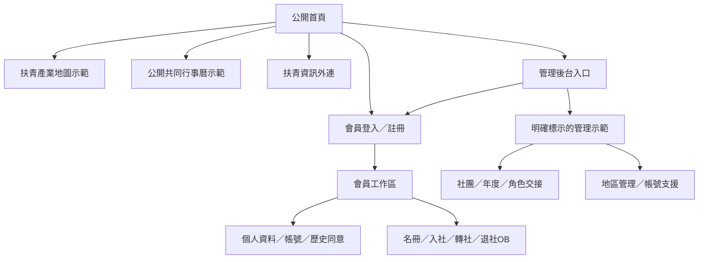
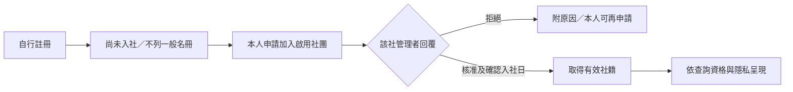
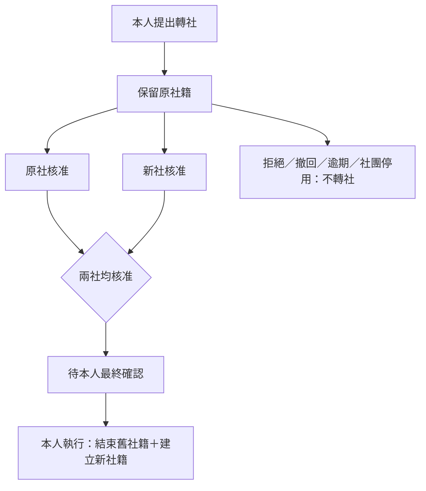
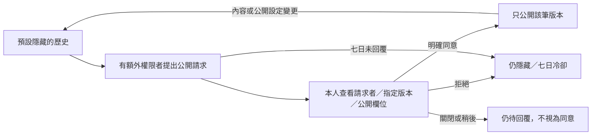

# UI／UX 畫面與互動規格 v0.5

日期：2026-10-15。對應目前 React 前端公開站與第一階段工作區，供畫面審閱、後端串接與後續需求變更使用。

第1～10節描述預設展示模式的假資料畫面；第11～12節補充本地核心 API 與帳號串接模式，不將已部署靜態網頁視為正式系統。需求依據為[需求基準](13-requirements-baseline.md)、[角色矩陣](14-role-matrix.md)與[第一階段契約](15-phase1-contract.md)；交付快照另見[工作區初版](19-phase1-ui-delivery.md)與[公開首頁](20-public-index.md)。

最新入口與逐頁改造、驗證見[v0.5交付](25-public-entry-and-page-upgrade.md)；v0.4改善背景見[前輪紀錄](24-ui-ux-improvements.md)。

## 1. 產品入口與資訊架構

公開站提供訪客探索，工作區處理會員與社團事務。沿用舊版 Rotaract 萬花筒品牌、紅色及「玩轉你的扶青年代」主標；公開站用暖色底、大標題與插畫，工作區用側欄、範圍列及白卡片。參考 Metronic Tailwind 的版面概念，現行元件與樣式為自行製作，不代表已取得或使用商用模板。

### 路由表

入口為 `main.tsx → Portal.tsx`，公開根網址只渲染PublicHome，不預載管理App。首次進入會員或管理入口才載入App，返回公開頁保持同次瀏覽的示範狀態。來源：[portalRoute.ts](../../frontend/src/portalRoute.ts)、[App.tsx](../../frontend/src/App.tsx)。公開網址採 GitHub Pages 子路徑，以下皆為網址的 hash 片段。

| 入口 | 片段 | 目前行為 |
| --- | --- | --- |
| 公開首頁 | `#/` 或無片段 | 匿名可看；不呈現工作區側欄與會員私人資料 |
| 產業地圖 | `#/map` | 商家關鍵字／地區篩選與詳情示範 |
| 共同行事曆 | `#/calendar` | 月曆、月份切換、公開活動詳情示範 |
| 會員登入 | `#/login` | 登入、忘記密碼及人工協助入口 |
| 註冊 | `#/register` | 註冊表單；成功進入會員工作區 |
| 管理後台入口 | `#/admin` | 登入畫面與另行標示的管理假資料體驗入口 |
| 會員工作區 | `#/workspace` | 本次記憶體內登入後進入；重整不保留 Session |
| 管理示範 | `#/demo` | 可切換示範身分的工作區，非正式授權入口 |

`#/BizMap` 及大小寫不敏感的 calendar 片段可解析；未知片段回首頁。這不是舊伺服器 `/BizMap` 路徑的重導。工作區內頁可使用 `#/workspace?view=account` 或 `#/demo?view=annual` 深連結；僅接受已知頁面，依目前角色回退。會員 ID、篩選與私人聯絡資料不放入 URL。工作區重新整理會清除操作結果。

## 2. 公開站畫面

來源：[PublicHome.tsx](../../frontend/src/features/PublicHome.tsx)、[public-home.css](../../frontend/src/features/public-home.css)。

| 畫面 | 主要內容 | 操作與狀態 |
| --- | --- | --- |
| 首頁 | 品牌導覽、主標、插畫、探索區、BizMap／Info／Kalendar 三入口、登入／註冊及管理入口 | 桌機橫向導覽；手機展開選單；Info 為明示的新視窗外連 |
| 產業地圖 | 合成商家、城市／產業、公司名、call name、所屬社團、分布示意圖 | 關鍵字／地區／產業篩選、清除篩選及結果筆數；點卡片或圖標開啟詳情；無結果有空狀態；登入後才提供會員查詢入口 |
| 商家詳情 | 公司介紹、營業聯絡資訊、call name／社團 | 關閉／Escape；回復開啟前焦點；不顯示會員私人電話或 Email |
| 共同行事曆 | 月標題、日曆格、公開活動列表、類別／時間／地點／主辦社團 | 上／下月、活動地區／類型篩選、月曆／列表切換（手機初載優先列表）、回到示範月份、活動詳情；其他月份無資料時提供回到 2026 年 10 月提示 |
| 活動詳情 | 活動名稱、時間、地點、主辦與介紹 | 彈窗預覽；沒有報名、付款、簽到或活動編輯功能 |

公開地圖是示意分布，沒有地理定位服務；公開活動是獨立合成資料。它們尚未套用後端的當年度社籍、公司審核或付費曝光資格，也不代表第二、三階段已實作完成。

## 3. 登入、註冊與復原

來源：[AccountViews.tsx](../../frontend/src/features/AccountViews.tsx)、[accountModel.ts](../../frontend/src/features/accountModel.ts)、[App.tsx](../../frontend/src/App.tsx)。

| 畫面 | 欄位／操作 | 回饋與限制 |
| --- | --- | --- |
| 登入 | Email／電話／帳號代號、密碼；登入、註冊、忘記密碼 | 成功進入本人工作區；失敗顯示提示；可顯示／隱藏密碼、欄位關聯錯誤；固定示範密碼 `DemoPass2026!`，不保存輸入密碼 |
| 註冊 | 姓名、call name、Email、示範密碼、選填電話 | 建立合成會員及亂數代號，預設尚未入社；必填、格式與識別重複檢查；註冊不自動取得名冊曝光資格 |
| 忘記／重設密碼 | Email、模擬重設連結、新密碼；重送、模擬經過 31 分鐘 | 請求回覆不作帳號存在證據；舊連結重送後失效、30 分鐘過期、成功後不能重用；不寄真實信件，不真的變更登入密碼 |
| 無法登入的人工協助 | 帳號復原說明及可回覆 Email；舊資料認領位於登入後帳號協助頁 | 建立案件回條並可查詢／補件；與登入後案件頁共用示範狀態；不是實際核身或資料移轉 |

人工支援的公開展示限制為示例 Email／文字，勿輸入真實證件、密碼或帳號證據。

## 4. 工作區畫面清單

### 共用框架

桌機固定側欄、頂部導覽、年度／身分與待辦入口；手機使用抽屜。頁首顯示標題、說明及相關主要操作。成功訊息使用 `role=status`，錯誤使用 `role=alert`，可關閉。工作區包含「體驗身分」、「目前授權地區」、「畫面情境」與重設示範資料工具；這些控制只供審閱，不能作為正式權限驗證。

| 頁面 | 主要欄位／內容 | 主要操作與狀態 |
| --- | --- | --- |
| 管理總覽 | 優先任務清單、年度、確認／待確認／待審統計、會員摘要 | 前往名冊與入社待辦；數字隨記憶體資料更新；未登入示範限制資料 |
| 會員名冊 | 姓名／call name、代號、社團、年度狀態；搜尋、社籍／社團／類型、特殊非正常社籍篩選；提供call name／姓名／入社日期新舊排序與清除條件 | 20／50／100 筆分頁；載入合成分頁資料；空結果；點會員進詳情；從未核准入社者不因特殊篩選出現 |
| 會員詳情 | 基本資料、社籍、歷史經歷三個分頁；異動紀錄為獨立頁 | 返回名冊；依本人隱私顯示電話／Email；管理角色不能因此取得私人聯絡值；鍵盤可切換詳情分頁 |
| 入社申請 | 本人申請／社團待審；所選社團、說明、狀態、實際入社日 | 本人新增／撤回；社團核准或附原因拒絕；展示逾期及停用終止；已有同類有效社籍或待審時阻擋重複申請 |
| 轉社作業 | 原社、新社、理由、雙社回覆、本人最終確認 | 本人提出／撤回；兩社各自核准或拒絕；雙方同意後仍保留原社籍，最後由本人執行；展示期限與停用終止 |
| 退社與 OB | 會員、結束類型、結束日、原因及確認欄；申請紀錄 | 本人送件／撤回；管理者審核或附理由直接辦理；完成結束社籍、保留預設隱藏的歷史；OB 為扶青畢業 |
| 年度名冊 | 年度社員、搜尋、只看待確認、選取列 | 單筆／批次確認；年度邊界情境工具；待確認與補確認；不將退社或 OB 重新轉成正常社員 |
| 社團資料 | 社團選擇、介紹、名稱、社徽、Email／網站／社群與逐項公開設定、停用狀態 | 有權者儲存；一般管理者不能編輯名稱／社徽；URL 限 HTTP(S)；停用保留資料 |
| 角色與交接 | 示範職務、授權清單、成員、角色、起訖日期 | 指定下任／新增授權／撤權；授權前摘要、撤權二步確認；一般管理者不能授權；展示生效與到期狀態；任期不得超過對應年度 6/30 |
| 個人資料 | 唯讀姓名／call name／電話／Email、編輯帳號入口、隱私 checkbox、社籍旅程、本人歷史公開開關 | 姓名／call name統一於帳號設定儲存；電話預設隱藏、Email 預設顯示給登入會員；聯絡變更導向帳號設定；管理示範身分須切回本人才能編輯 |
| 帳號設定 | 三分頁：基本資料與頭像、登入聯絡資料、帳號代號；目前密碼 | 每次選一種聯絡方式並驗密碼；代號只改一次、舊值保留；錯誤不更新資料；頭像先預覽後儲存；未存標記、放棄與離頁確認 |
| 歷史與同意 | 社團／期間／公開狀態、本人待辦、管理協助與例外欄 | 本人逐筆公開／隱藏；管理者額外勾選授權情境後可隱藏或請求同意；平台例外另需明確勾選、理由及密碼 |
| 異動紀錄 | 動作、日期、操作者與目標摘要；依身分限制範圍，可見資料內搜尋與新舊排序 | 本人／本社／目前轄區／帳號支援範圍顯示；不輸出密碼與 token；本版為前端事件列表，非不可竄改日誌 |
| 地區管理 | 授權地區、轄內社團、異動原因、跨區提案、建立社團 | 新增扶青社；附原因與影響摘要、二步確認停用／恢復；來源及目標地區分別核准跨區；現行歸屬同步影響名冊與管理範圍 |
| 帳號協助 | 復原／舊資料認領案件、說明、補件、處理理由與結果 | 本人送件／補件；平台要求補件、核准或拒絕；核准後示範本人信箱確認／重設或關聯確認；不真的合併資料 |

### 帳號及媒體細節

- 帳號代號：6～20 字元英數與底線、不分大小寫、唯一；畫面顯示剩餘修改次數，用完後停用表單。永久內部會員 ID 與可改一次的登入代號分開。
- 聯絡資料：一次只改電話或 Email。電話使用含國碼格式；Email 比對不分大小寫。此版檢查與唯一性僅及於本次合成資料。
- 頭像：PNG／JPEG／WebP，最多 2 MiB、4096×4096；重新編碼、縮放至最多 512 像素，在本次記憶體內預覽。不含真正檔案儲存與後端 ownership 檢查。
- 姓名／call name、頭像與登入方式統一在帳號設定編輯；個人資料頁檢視資料並管理隱私。帳號三分頁保留非密碼草稿，切頁清密碼；帳號及社團編輯有離頁保護，其他表單尚未全面涵蓋。

來源：[App.tsx](../../frontend/src/App.tsx)、[MemberOperations.tsx](../../frontend/src/features/MemberOperations.tsx)、[OrganizationViews.tsx](../../frontend/src/features/OrganizationViews.tsx)、[HistorySupportViews.tsx](../../frontend/src/features/HistorySupportViews.tsx)。

## 5. 角色與可見範圍

本表描述目前示範導覽，正式角色必須由伺服器逐請求執行[角色矩陣](14-role-matrix.md)，不能用隱藏選單替代。

| 示範身分 | 可進入的主要頁面 | 重要限制 |
| --- | --- | --- |
| 匿名訪客 | 公開首頁、地圖／行事曆、登入／註冊、人工協助 | 無匿名會員查詢；進管理入口不自動獲得權限 |
| 會員本人 | 總覽、名冊、本人入社／轉社／退社OB、個資、帳號、歷史、本人異動、帳號協助 | 沒有社團／年度／角色／地區管理頁；不能核准自己的社團申請 |
| 社團管理示範 | 總覽、本社名冊與待辦、年度、社團、角色、歷史與異動 | 聯絡隱私仍有效；角色頁中的一般管理者只能看授權，不能升權；個資頁要求切回本人 |
| 地區管理者 | 轄內名冊、社團、角色交接協助、地區、歷史與異動 | 範圍跟隨目前社團地區；不代替轉社雙社回覆；不自授平台權 |
| 平台帳號支援 | 帳號協助、歷史、異動 | 不是通用超級管理員；歷史例外需另外確認示範授權，不能因平台稱謂自動操作 |

歷史協助及例外的 checkbox 是展示特定授權存在與否；正式 `history:moderate`／`history:override` 授權、MFA、到期及撤權尚待後端。角色授權畫面也沒有將本次設定轉成真正 Session 權限。

## 6. 核心流程與 UX 決策

### 註冊至被查詢

### 三段轉社

### 歷史公開同意

本人可不經管理請求直接決定自己的逐筆公開設定。平台例外操作為另一受控分支，須指定授權、密碼及理由；正式版還需 MFA 與伺服器稽核。

### 年度與社團停用

扶輪年度 7/1 至隔年 6/30；工作區有 7 月寬限、8/1 待確認的情境展示與補確認。年度時間為示範控制，不是真實排程。停用社團會終止未完成入社與相關轉社、保留原社籍；恢復不重啟原案件。跨區需來源與目標各自核准，完成後採目前社團歸屬計算管理範圍。

## 7. 視覺規範：實際 CSS 值

需求基準 B08 提供的是初始目標色票；以下記錄目前 CSS，兩者尚未完全一致。不是已完成的全站設計 token 系統。

| 項目 | 目前值／規則 | 來源 |
| --- | --- | --- |
| 主品牌 | `--brand: #c8102e`；主要按鈕 hover `#a50d27` | `styles.css` |
| 工作區底／正文 | `#f6f7fa`／`#253049` | `:root` |
| 次要文字／邊框 | `--muted: #7b8395`／`--border: #eef0f4` | `:root` |
| 表面／選中導覽 | 白色／`#fceef1` 配品牌文字 | `.panel`／`.nav-item.active` |
| 公開站底／正文 | `#faf8f3`／`#342d29`，暖色邊框 `#e8e1d7` | `.ph-site`／`.ph-header` |
| 字體 | Inter、Noto Sans TC、PingFang TC、Microsoft JhengHei、sans-serif；根字級 15px | `:root`；未因此保證已載入網路字型 |
| 工作區標題／卡片標題 | 頁面 h1 29px；panel h2 18px | `.page-heading h1`／`.panel-header h2` |
| 輸入元件 | 白底、8px 圓角、10px 12px padding、最低 44px，文字輸入16px | `input, textarea, select` |
| 按鈕 | 工作區最低 44px、7px 圓角；公開主要按鈕最低 48px、3px 圓角 | `.button`／`.ph-button` |
| 卡片 | 約 10～12px 圓角、淺灰細邊框；間距以各元件 CSS 為準 | `.panel`／`.stat-card` 等 |
| 焦點 | `3px solid #c8102e60`、offset 3px | `:focus-visible` |
| 狀態 | confirmed 綠；unconfirmed 黃；OB／退出灰，另附狀態文字 | `.badge.*` |
| 表單回饋 | 成功淺綠；錯誤淺紅，搭配文字及 alert／status | `.notice`／`.notice.error` |

[工作區 CSS](../../frontend/src/styles.css)與[公開站 CSS](../../frontend/src/features/public-home.css)仍含多組硬編碼色票；本輪已將原小字提高至至少12px，仍須逐頁校準輔助文字。不能據此宣稱符合完整 WCAG AA 對比、閱讀性與觸控尺寸。正式視覺校準應處理這些差距。

## 8. RWD、鍵盤與狀態

- 工作區：桌機側欄 245px，1200px 以下縮減；1023px 以下改抽屜與會員卡片；700px 以下調整頂列、內容 padding 與欄位堆疊；另有 420px 小螢幕規則。公開站有 1100／820／560px 斷點，820px 以下改手機導覽。
- 公開站內容容器最大 1240px，工作區 main 最大 1600px；主要內容避免以桌機表格直接撐出手機畫面。
- 使用語意按鈕、表單 label、可見 focus、跳至主要內容入口、詳情分頁鍵盤操作；工作區採原生 dialog，公開詳情採具有焦點限制的 dialog 語意容器；彈窗關閉不代表送出或同意。路由切換會關閉原浮層並回頁首；工作區換頁聚焦主要內容。
- CSS 尊重 `prefers-reduced-motion`。仍須另做讀屏軟體、縮放、色彩對比與實際裝置驗收；現有瀏覽器流程不等同完整無障礙認證。
- 工作區有正常／載入中／離線／資料衝突／無權限／登入逾時情境。衝突等情境暫時隱藏並停用原表單互動，重試後回復正常並保留草稿；逾時導回登入。這些是手動情境展示，尚未處理真實 HTTP 狀態與 Session。
- 名冊、活動月份與案件各有空狀態；表單以必填／格式檢查及操作訊息回饋失敗。未宣稱所有頁面均有自動載入、429 限流、404、服務重試或離頁未存提醒。

## 9. 畫面參考與可追溯來源

截圖是特定交付版本快照，可能不含後續修補；可操作程式與本次驗證紀錄優先。

| 畫面 | 桌機 | 手機 |
| --- | --- | --- |
| 公開首頁 | [公開首頁桌機](../previews/public-index-desktop.png) | [公開首頁手機](../previews/public-index-mobile.png) |
| 產業地圖 | [地圖桌機](../previews/public-map-desktop.png) | — |
| 共同行事曆 | [行事曆桌機](../previews/public-calendar-desktop.png) | — |
| 登入入口 | [登入桌機](../previews/public-login-desktop.png) | — |
| 第一版管理工作區 | [管理桌機](../previews/phase1-desktop.png) | [管理手機](../previews/phase1-mobile.png) |
| 帳號設定 | [帳號桌機](../previews/phase1-v2-account-desktop.png) | [帳號手機](../previews/phase1-v2-account-mobile.png) |

業務狀態來源：[domain.ts](../../frontend/src/domain.ts)、[organizationModel.ts](../../frontend/src/features/organizationModel.ts)、[historySupportModel.ts](../../frontend/src/features/historySupportModel.ts)。既有可重跑驗證入口為[前端說明](../../frontend/README.md)與 [scripts](../../frontend/scripts/)。本文件以程式及既有交付紀錄整理；本輪 bug 發現、修正與實際重跑結果見[UI／UX 檢查紀錄](22-ui-ux-qa.md)。

## 10. 假資料邊界與後續 To-do

### 本版已有畫面

- [x] 公開首頁與會員／管理入口分離。
- [x] 第一階段會員、社籍、組織、角色、年度、歷史同意與支援案件的可操作初版。
- [x] 搜尋／分頁、手機抽屜與卡片、基本鍵盤／彈窗及錯誤情境示範。
- [x] 公開商家／活動最小預覽，供首頁入口審閱。

### 正式串接與 UX 差距

- [x] 本地核心模式：真實登入、Session／CSRF、停撤權、限流與密碼雜湊，無示範身分選單；見第11節。
- [ ] MFA、密碼復原及其餘帳號管理操作正式串接。
- [ ] 接上 [OpenAPI](../api/openapi.json)；由後端處理範圍投影、原子唯一性、版本／409、交易競爭、冪等與時區邊界。
- [ ] 後端分頁與搜尋、非正常社籍查詢、原社備查隔離；不將全量私有資料下發後再由瀏覽器隱藏。
- [ ] 正式頭像／社徽上傳、資產 ownership、型別重編碼與儲存；支援證據存取與期限清理。
- [ ] 年度排程、角色到期、跨區與社團停用事件、同意版本失效及不可竄改稽核。
- [ ] 真實帳號復原／舊資料認領、獨立核身、一次性確認與資料移轉；目前只有案件操作示範。
- [ ] 補齊真實 401／403／404／409／429／服務失敗 UX、未儲存離頁提醒與密碼清理；檢查長文、縮放與讀屏。
- [ ] 延續v0.4共用文字／控制token，完成逐頁對比、觸控及讀屏稽核；正式品牌資產與模板授權確認。
- [ ] 扶輪社並存模型及操作整合；目前可建立的操作流程以扶青社為主，扶輪社選項為整合預留。
- [ ] 活動／公開社團頁、公司地圖、付費曝光、優惠兌換按後續階段實作，不以目前首頁預覽充當正式交付。

預設展示模式的資料只在記憶體中，重整即還原；本地核心模式另使用 PostgreSQL。尚無正式資料庫部署、郵件、地圖 API、金流、檔案服務或真實個資。正式環境前仍需完整權限與整合驗收。

## 11. 本地核心 API 模式

`VITE_API_MODE=live` 時，會員與管理入口懶載入 `LiveWorkspace`；根路徑仍是公開首頁，地圖及行事曆仍為展示資料。回首頁時不渲染私有資料 DOM，保留同次掛載狀態。這是獨立的核心流程頁面，不代表預設工作區全部功能已串接。

| 畫面 | 行為與狀態 |
| --- | --- |
| 註冊 | 姓名、call name、Email、選填國際電話、12～128 Unicode碼點密碼；成功顯示亂數代號並回登入，不自動入社或登入 |
| 登入 | Email／電話／代號與密碼；Session及管理範圍由API提供；錯誤顯示訊息與requestId |
| 我的入社申請 | 啟用社團選單、申請說明、送出與進度列表；核准前不出現在名冊 |
| 社團入社審核 | 僅列有效本社授權範圍；實際入社日以台北今日為上限；核准後重讀狀態 |
| 會員名冊 | 登入後搜尋與分頁；名冊不含聯絡資訊；詳情僅顯示API允許的Email／電話，隱藏欄標示未公開 |

CSRF token及重送key僅保留記憶體；結果未知時同輸入重用key，變更輸入換key，成功或登出清除。API錯誤不自行假設成功；401回登入，撤權後重新取得管理範圍。表單未儲存離頁提醒、完整讀屏驗收與其餘管理操作仍待後續完善。

已用真實HTTPS API完成註冊至名冊的瀏覽器驗證及360px檢查，詳見[核心交付與剩餘待辦](26-core-api-integration.md)。

## 12. 本地帳號與隱私設定

登入後的「我的帳號」提供四個區塊：姓名／call name、聯絡資料隱私、單項聯絡方式變更及一次會員代號變更。資料由Me取得；會員資料版本與帳號版本分開，不把畫面上的角色或帳號ID當成可修改欄位。

- 姓名與call name可自行調整。頭像上傳仍待資產服務。
- 電話與Email以checkbox控制登入後詳情是否公開；不影響公司公開聯絡方式。
- 每次電話或Email變更都要目前密碼，只送出一個kind與newValue；成功後同步輪替Session及CSRF。
- 代號修改前確認一次性限制，成功後顯示剩餘0次並移除再次修改表單。
- 密碼驗證失敗保留非密碼草稿、清除密碼；重新探測Me確認Session。只有Session真正失效才清除私有畫面與快取並回登入。
- 409保留草稿、不覆寫資料；明確重新讀取前確認捨棄。離開帳號分頁、前往首頁與關閉頁面有未儲存提醒；送出期間鎖住表單，避免回應覆蓋正在編輯的內容。

真實API與UI驗證、限制及待辦見[帳號串接紀錄](27-account-and-privacy-integration.md)。
