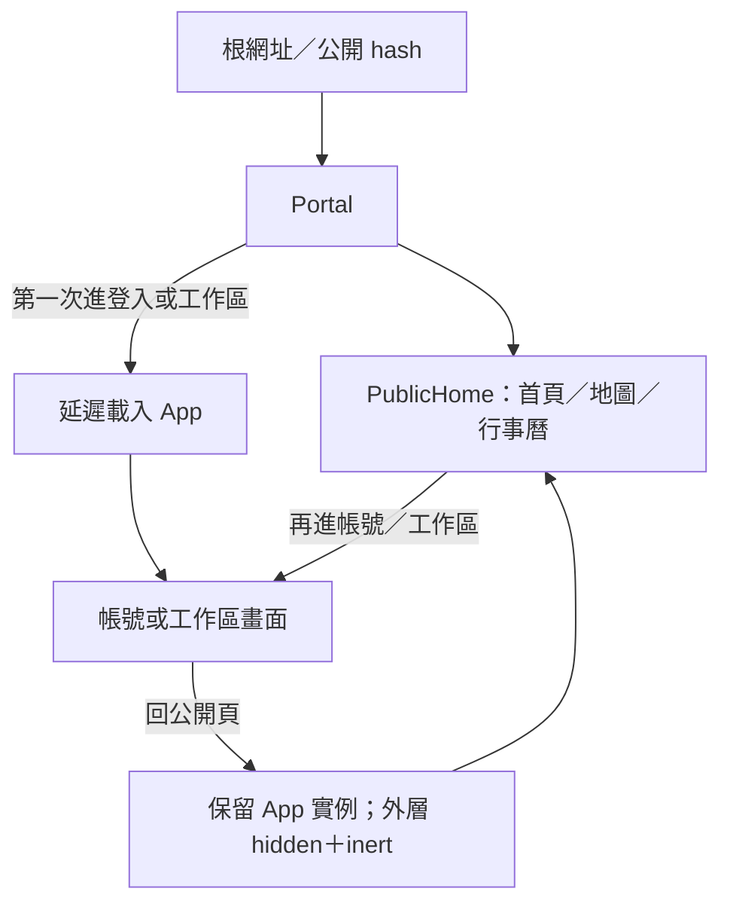

# 公開入口與全頁 UI／UX 升級 v0.5

日期：2026-10-15。回應使用者「根網址應開啟公開首頁」與「全部畫面繼續提升」的要求。此文件記錄本輪實際程式變更與逐頁覆蓋，最終版本、驗證及發布結果由主代理補上。

公開體驗請使用根網址：[Rotaract 萬花筒首頁](https://xk2022.github.io/codex-xk-rotaract/)。先前提供的 `#/demo` 本來就會直接開啟管理假資料工作區，不是公開首頁。本輪不再以它作為公開體驗連結。

這是前端可操作初版的升級，沒有「120 分」認證、完整 AA 認證或使用者研究證據；不將主觀評分作為完成標準。

## 1. 公開入口的實際結構

來源：[main.tsx](../../frontend/src/main.tsx)、[Portal.tsx](../../frontend/src/Portal.tsx)、[portalRoute.ts](../../frontend/src/portalRoute.ts)。

- React 預設入口改為 `Portal`；公開站不在啟動時直接載入整個管理 App，第一次進入非公開頁才延遲載入工作區。
- 已進入過工作區後，返回公開頁保留工作區實例；外層 `hidden` 與 `inert` 隱藏並停止互動，內嵌 App 在公開路由回傳空內容，避免同時出現管理畫面或多份主內容。
- 返回首頁後再登入，仍可使用本次記憶體內建立的合成會員；不因公開／工作區切換重新建立全部示範狀態。重新整理整個網頁仍會還原資料。
- hash 路由在所有事件監聽完成後的下一個工作讀取最後接受的 URL，讓工作區未儲存確認可取消切換。本輪實際重現「微任務過早隱藏編輯器」問題，已改為下一個task並加入取消後畫面／網址／草稿回歸檢查。
- 工作區首次載入提供等待畫面；畫面載入失敗提供重新載入與返回公開首頁。這些回復入口不代表所有網路與部署故障都已定位。

新增瀏覽器案例已驗證根網址不請求管理App、不出現管理DOM、註冊→回首頁→再登入狀態接續、取消草稿離頁，以及強制中斷管理App載入後的回復入口。

## 2. 逐頁覆蓋與驗證追蹤

以下「已改」指程式存在對應實作，不等同全部互動已完成最終驗收。「待最終」由主代理依修補後版本及 `browser-all-pages` 結果補證；舊版測試通過不能自動替代新增案例。

### 公開頁與帳號入口

| 畫面／狀態 | 本輪改動 | 最終驗證狀態 |
| --- | --- | --- |
| 根網址／公開首頁 | 公開入口獨立、工作區延遲載入；中文主操作與三入口文字更直接，保留品牌與插畫 | 已檢查：根網址無管理模組請求、無後台 DOM；桌機／手機 |
| 商家地圖 | 關鍵字、地區外新增獨立產業篩選；清除篩選與空結果回復入口 | 已檢查：產業篩選、清除、1440／360px |
| 商家詳情 | 以資訊項目呈現聯絡與社團脈絡，明示示範內容及會員查詢邊界 | 已檢查：開關詳情、鍵盤及焦點回復 |
| 共同行事曆 | 活動地區／類型篩選、清除、月曆／列表切換；手機使用較易讀的活動列表 | 已檢查：篩選、列表、月份空狀態與手機 |
| 活動詳情 | 分組呈現地區、時間等資訊，明示尚未開放報名 | 已檢查：詳情、關閉與焦點 |
| 扶青資訊外連 | 保留既有外部入口，中文說明連結用途 | 已檢查：入口標示；不評外部網站內容 |
| 會員登入 | 密碼顯示／隱藏、清楚登入步驟、欄位及操作失敗回饋 | 已檢查：切換密碼可見性、登入及欄位錯誤 |
| 管理登入入口 | 先登入，明確分開管理假資料體驗；不因入口賦予權限 | 已檢查：入口與狀態提示 |
| 註冊 | 姓名／call name、登入資料與下一步分段，保留欄位錯誤與註冊後入社說明 | 已檢查：註冊後回首頁再登入同一合成會員 |
| 忘記／重設密碼 | 步驟與欄位回饋分層，延續重送、過期及一次性連結示範 | 已檢查：原復原流程回歸；不寄真實郵件 |
| 匿名人工協助 | 回條查詢、建立案件分段；卡片顯示目前進度與下一步 | 已檢查：查詢／補件／空狀態與手機 |

### 全部 14 個工作區頁面

工作區共用導覽依任務分組，顯示目前操作範圍；角色只看到可用入口。深連結仍為既有已知頁面，不把新網址當作授權。

| 頁面 | 本輪改動 | 最終驗證狀態 |
| --- | --- | --- |
| 管理總覽 `overview` | 任務優先、範圍與下一步更清楚；會員摘要只取正常名冊資格資料 | 已檢查：各角色任務、摘要隱私、1440／360px |
| 會員名冊 `members` | 新增排序與清除條件，統整範圍、搜尋／篩選／分頁 | 已檢查：角色範圍、排序清除、手機卡片 |
| 入社申請 `applications` | 審核操作及欄位錯誤就近回饋，區分本人申請與社團待辦 | 已檢查：核准／拒絕／撤回及錯誤 |
| 轉社作業 `transfers` | 加強雙社進度及誰接續處理的提示，保留本人最後執行與原社籍備查 | 已檢查：雙社核准→本人執行、失敗分支 |
| 退社與 OB `membership` | 辦理內容與異動依據分段，加上步驟和影響摘要 | 已檢查：本人申請、管理直接辦理及重複操作 |
| 年度名冊 `annual` | 步驟、選取與確認分層；批次結果摘要與未完成項目重試說明 | 已檢查：批次成功／部分失敗、年度邊界與手機 |
| 社團資料 `club` | 社團識別、介紹聯絡、公開範圍分段；無可編輯資料時有空狀態 | 已檢查：職務欄位限制、儲存及草稿保護 |
| 角色與交接 `roles` | 授權清單、指定下任與範圍摘要分層；補強清單空狀態 | 已檢查：授權／撤權、任期、一般管理者限制 |
| 個人資料 `profile` | 唯讀基本資料及隱私分組，明確導向唯一帳號編輯入口 | 已檢查：本人限定、隱私及入口 |
| 帳號設定 `account` | 延續三分頁與草稿保護，強化欄位分組、錯誤、頭像儲存與單項登入資料操作 | 已檢查：分頁／清密碼／頭像／代號及離頁 |
| 歷史與同意 `history` | 歷史卡片、狀態、步驟與本人待辦更集中；保持指定版本同意及管理協助邊界 | 已檢查：本人同意／拒絕、關閉不批准、授權範圍 |
| 異動紀錄 `audit` | 搜尋排序配合卡片／時間脈絡呈現，區分無紀錄與查無結果 | 已檢查：僅搜尋範圍內紀錄、排序清除、手機 |
| 地區管理 `district` | 轄內社團、跨區提案、新增社團分組，空狀態及高影響操作脈絡更清楚 | 已檢查：停復用、雙地區核准、範圍變化 |
| 帳號協助 `support` | 案件卡片、處理階段／時間線及下一步，清楚區分申請、補件與核准後本人確認 | 已檢查：會員／平台操作、補件及後續確認 |

會員詳情屬名冊內的子畫面：基本／社籍／歷史三分頁、返回列表與私人聯絡投影仍保留；本輪共用文字、卡片與範圍提示同步更新。待最終複核分頁鍵盤與列表上下文。

### 共用狀態與 RWD

| 狀態 | 本輪處理 | 最終驗證狀態 |
| --- | --- | --- |
| 首次載入會員服務 | Suspense 等待畫面及返回首頁 | 已檢查：延遲載入與回復入口 |
| 畫面渲染／載入失敗 | 錯誤邊界，重新載入／返回公開頁 | 已檢查：對應故障情境；不推定已覆蓋所有錯誤 |
| 空資料／查無結果 | 各頁提供原因與回復動作，避免空白區 | 已檢查：公開篩選、組織、案件及紀錄 |
| 欄位錯誤／審核錯誤 | 就近呈現必要提示並保留可修改的輸入 | 已檢查：新欄位與原流程回歸 |
| 離線／衝突／無權限／逾時 | 保留既有假資料情境、重試與草稿規則 | 已檢查：既有狀態回歸；不是真實 API 錯誤 |
| 未儲存與取消離開 | Portal 等待工作區接受的 URL，尊重原草稿確認 | 已檢查：取消回首頁不丟草稿、不換畫面 |
| 手機／桌機 | 公開活動列表、工作區分組導覽、分段表單與卡片；共用閱讀／控制尺寸 | 已檢查：1440／360px 所有角色可見頁；無水平溢出不等於完整可用性通過 |

## 3. 程式與畫面來源

- 公開站：[PublicHome.tsx](../../frontend/src/features/PublicHome.tsx)、[公開 CSS](../../frontend/src/features/public-home.css)。
- 框架、導覽、名冊、審核及註冊：[App.tsx](../../frontend/src/App.tsx)、[styles.css](../../frontend/src/styles.css)。
- 帳號：[AccountViews.tsx](../../frontend/src/features/AccountViews.tsx)；組織：[OrganizationViews.tsx](../../frontend/src/features/OrganizationViews.tsx)。
- 社籍及年度：[MemberOperations.tsx](../../frontend/src/features/MemberOperations.tsx)；歷史／案件／稽核：[HistorySupportViews.tsx](../../frontend/src/features/HistorySupportViews.tsx)。
- 本輪已存在的畫面：[v0.5 公開首頁桌機](../previews/v05-home-desktop.png)。另有[首頁手機](../previews/v05-home-mobile.png)、[商家地圖](../previews/v05-map-desktop.png)、[活動列表](../previews/v05-calendar-desktop.png)、[登入](../previews/v05-login-desktop.png)、[會員名冊](../previews/v05-taipei-會員名冊.png)、[角色交接](../previews/v05-taipei-角色與交接.png)、[歷史同意](../previews/v05-member-歷史與同意.png)與[平台支援](../previews/v05-platform-帳號協助.png)。

## 4. 驗證證據與待補項目

最終整合由主代理實際執行：

| 檢查 | 結果 | 邊界 |
| --- | --- | --- |
| TypeScript／Vite建置 | 通過；公開entry與管理App分開產出chunk | 不等於正式後端已驗收 |
| 單元測試 | 41項通過 | 模型及路由解析 |
| 既有五套瀏覽器流程 | smoke、v2、public、ux、enhancements通過 | 保留既有入社／轉社／隱私／草稿等行為 |
| `test:browser:all` | 30組角色／頁面組合在1440及360px通過，無瀏覽器例外或水平溢出 | 不等同使用者研究或全裝置認證 |
| 正式打包子路徑 | `/codex-xk-rotaract/` 執行新增整套流程通過 | 根網址、無尾斜線、公開篩選、註冊接續、密碼切換與錯誤回復 |
| 根入口隔離 | 初始公開頁沒有管理App網路請求與側欄DOM | 明確進後台才按需載入；不能將`#/demo`誤當首頁連結 |
| 故障回復 | 模擬管理chunk請求失敗，可回公開首頁 | 非所有外網問題已排除 |
| 獨立審查 | 入口與保護機制複核；文案修正為核准後本人資料才曝光 | 不宣告120分或AA認證 |

部署流程已加入Chromium及正式建置公開入口／全頁流程檢查，通過才上傳Pages產物。發布紀錄於部署完成後附錄。

## 5. 交付邊界與後續 To-do

- [x] 根入口渲染公開站，第一次進非公開區才載入工作區程式。
- [x] 保留既有記憶體狀態並尊重未儲存確認，分開公開與管理內容。
- [x] 公開、登入／註冊及全部 14 個工作區頁均有本輪 UI／UX 改動。
- [x] 完成最終回歸、獨立審查及版本紀錄；發布結果見後附。
- [ ] 使用者以公開根網址試用；先前特定裝置的異常仍須實際重現與證據，不能只因入口改造便宣稱全部解決。
- [ ] 正式後端、範圍授權、Session、資料庫交易、郵件、檔案及真正地圖／活動資料串接。
- [ ] 真實社員與管理者任務研究、無障礙、實機及效能檢查。

全部資料仍為合成、記憶體狀態，重整即還原；示範登入與角色切換不提供正式安全保證。公開地圖、活動、核身、稽核及資料認領仍不是正式服務。本輪沒有新增付款、活動報名或平台通用超級管理權，原[需求基準](13-requirements-baseline.md)與[角色矩陣](14-role-matrix.md)維持有效。
